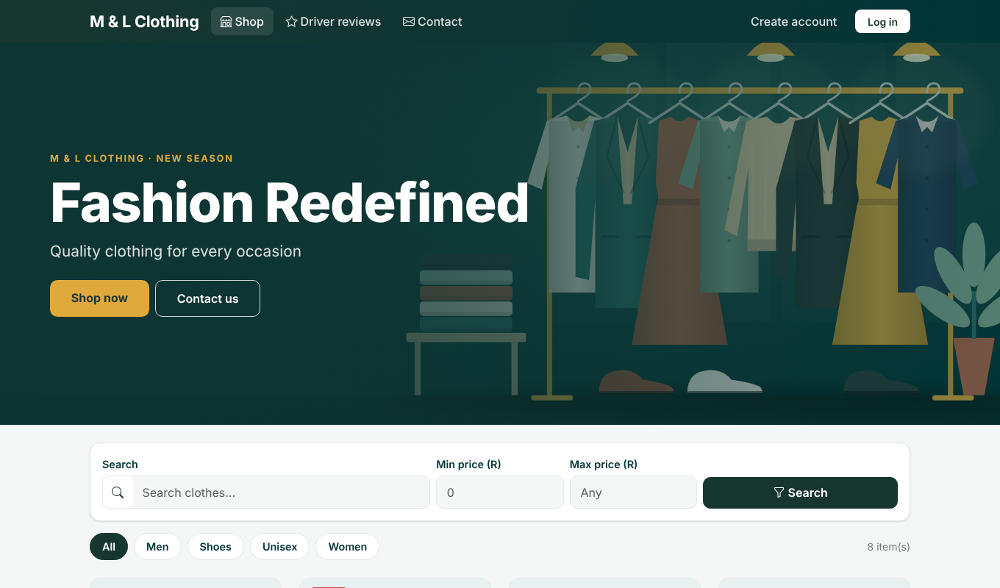
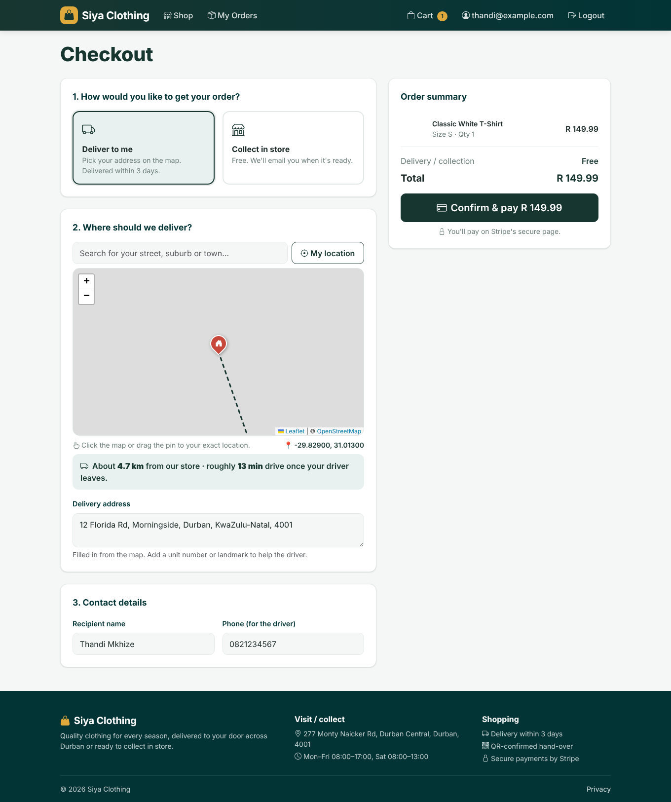
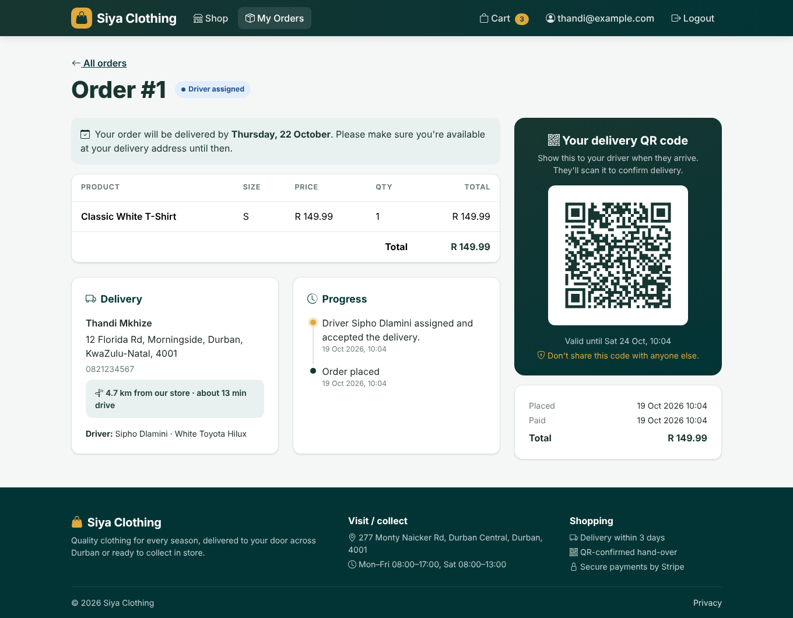
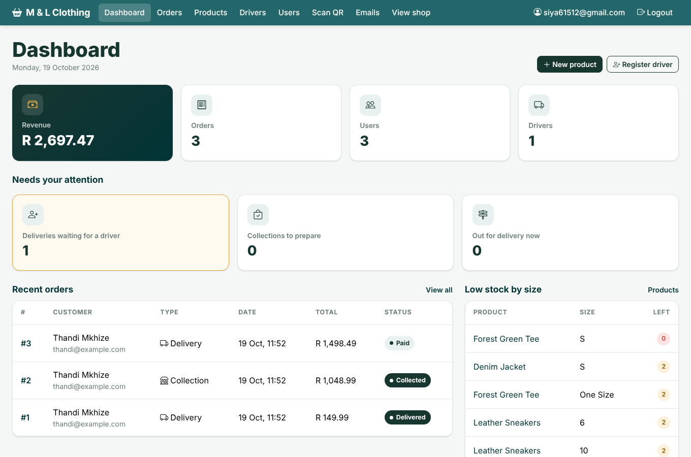
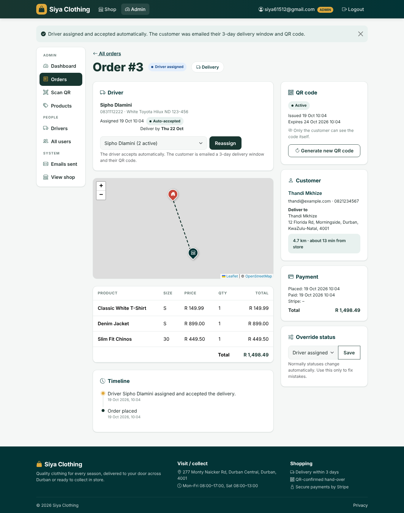
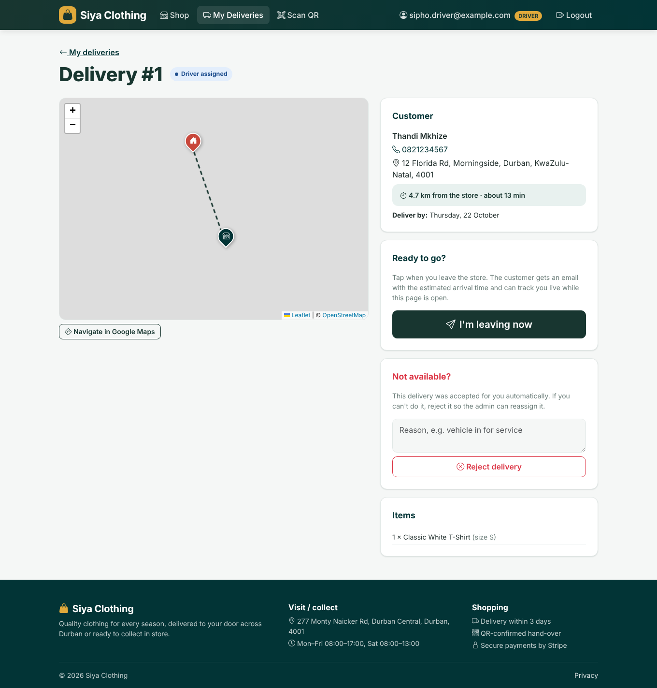
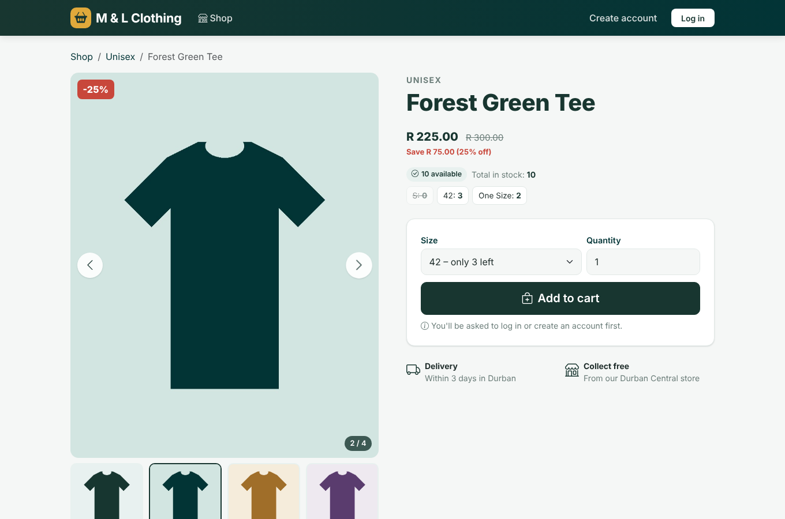
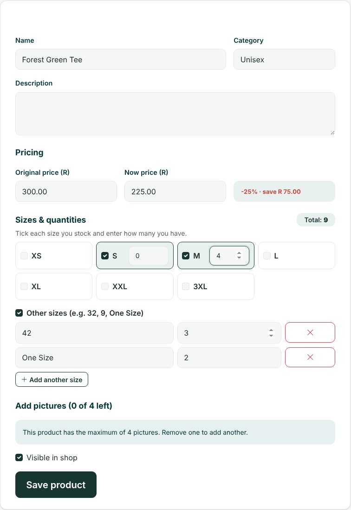
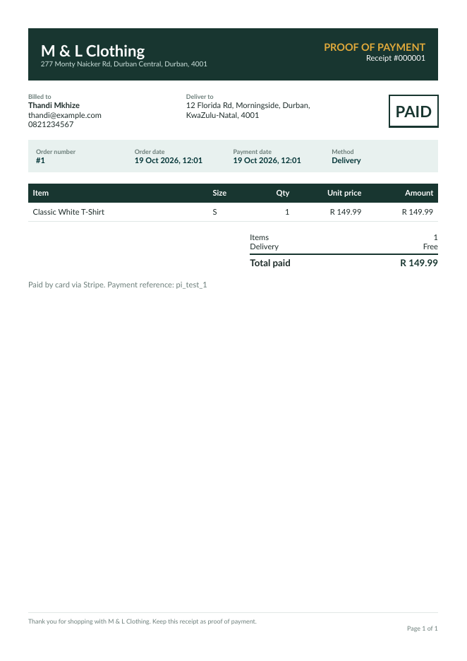
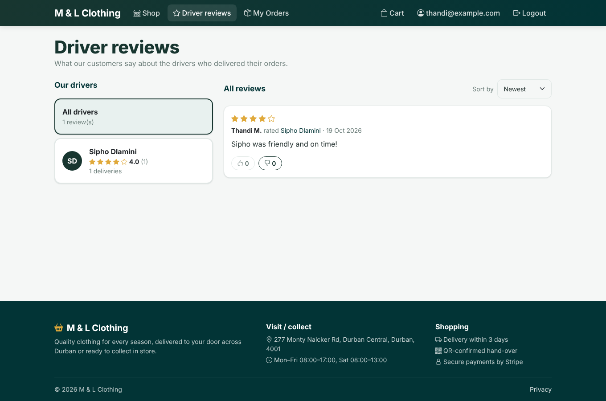

# M & L Clothing – ASP.NET Core MVC store with Stripe, drivers and QR delivery

An online clothing shop built with **ASP.NET Core MVC (.NET 10)**, **ASP.NET Identity**, **Entity Framework Core (SQLite)**,
**Stripe Checkout** and **OpenStreetMap** (Leaflet). Store: **277 Monty Naicker Rd, Durban Central, Durban, 4001**.

| Shop | Checkout with map | Customer QR |
| --- | --- | --- |
|  |  |  |

| Admin dashboard | Admin order | Driver delivery |
| --- | --- | --- |
|  |  |  |

| Product page (< > pictures, stock per size) | Adding sizes and quantities | Proof of payment (PDF) |
| --- | --- | --- |
|  |  |  |

| Driver reviews |
| --- |
|  |

## Who can do what

**Customers**
- A large photo banner ("Fashion Redefined") opens the shop page, with **Shop now** and **Contact us** buttons.
  Change the photo and text in `appsettings.json` → `Store`: `HeroTitle`, `HeroSubtitle`, `HeroImageUrl`.
- **Contact us** page: store address, hours, map and a message form. Messages are emailed to `Store:Email`
  (or the admin email if that's empty) and also appear under **Admin → Emails sent**.
- Search by name, category and **price range** (minimum and maximum).
- Browse clothing without logging in: up to 4 pictures per item (use the **< >** arrows, keyboard arrows or swipe),
  sale price with the original price crossed out, **% off and amount saved**, the **total quantity** and
  **how many are left in each size**. Sold-out sizes can't be chosen.
- Clicking **Add to cart** while logged out sends you to **Login**; after logging in the item is added.
- Register with Name, Surname, Email, Gender, Date of birth, Phone, Home address (**pick it on the map**), City, Province,
  Postal code, Password and Confirm password.
- Checkout: choose **Deliver to me** (pick the address on the map; shows distance, estimated drive time and the
  **delivery fee**) or **Collect in store** (free). The fee is added to the order total, the Stripe payment and the receipt.
- **Delivery fee**: R90 for up to 10 km; beyond 10 km, R90 + R10 for every extra km (a started km counts as a
  full km, e.g. 12.3 km = R120). Distance is estimated from the store to the pin on the map.
- **Proof of payment**: as soon as payment is confirmed the customer is emailed a receipt listing the items, with a
  PDF attached. On the order page they can **Download PDF** or **Email it to me again**.
- **My Orders**: filter by **delivery status** (driver assigned, out for delivery, delivered, ready to collect,
  collected…), sort **newest or oldest purchase first** and filter **from date – to date**; progress timeline, the **QR code** (only the customer can see it), and **live driver tracking** with an
  estimated arrival time once the driver leaves.

**Driver reviews** (menu: *Driver reviews*, public)
- After a delivery is confirmed, the customer can rate the driver **1–5 stars** with a comment, once per order
  (on the order page).
- Everyone (even visitors who aren't logged in) can read all reviews and each driver's average rating; sort by
  newest, oldest, highest, lowest or most liked; pick a driver to see only their reviews.
- Logged-in users (customers, drivers, admin) react with **👍 like** or **👎 dislike**; clicking again removes it.
  Drivers can't react to reviews about themselves. Customers are shown as first name + surname initial.
- Admin can delete inappropriate reviews. Drivers see their own rating on *My Deliveries*; admin sees each
  driver's rating on *Drivers*.

**Admin** (`siya61512@gmail.com` / `Siyabonga@2`, created on first run)
- Admin pages use a **top menu bar** (Dashboard, Orders, Products, Drivers, Users, Scan QR, Emails).
- Dashboard: revenue, users, drivers, what needs attention (deliveries waiting for a driver, collections to prepare)
  and **low stock by size**.
- **Drivers**: register drivers (only the admin can), edit them, see their active and completed deliveries.
- **Orders**: download or re-send a customer's receipt PDF, assign a driver (accepted automatically), mark collection orders ready, see the QR status
  (**Active / Used / Expired**) and **generate a new QR code**, override status.
- **Scan QR** to confirm in-store collections.
- **Products**: original price + now price, **up to 4 pictures** (upload or paste a link), choose the main picture.
  **Sizes**: tick XS–3XL and enter a quantity for each; tick **Other sizes** to add any size by name or number
  (e.g. 32, 9, One Size) with its quantity. The product total is the sum of all sizes, and buying a size
  reduces only that size's stock.
- **Users**: search, edit, lock, make admin, reset password, delete.
- **Emails sent**: every email the system sent (or would have sent).
- Admins (and drivers) have no cart or "My Orders": they don't buy.

**Drivers** (log in with the email/password the admin set)
- **My Deliveries**: assigned orders, customer phone and address, map and a "Navigate in Google Maps" button.
- Deliveries are **accepted automatically**. A driver can **reject** one (with a reason) before leaving if they aren't
  available; the admin is emailed and the order goes back to "needs a driver".
- **I'm leaving now**: the customer is emailed with the estimated arrival time, and the driver's phone shares its live
  location while the page is open.
- **Scan QR** at the door to confirm delivery (or use the phone's normal camera on the code).

## Delivery flow

1. Customer pays → order is **Paid**.
2. Admin assigns a driver → **Driver assigned** (auto-accepted). The customer is emailed:
   *"Your order will be delivered within 3 days from today… please make sure you are available between these 3 days"*,
   with their QR code attached. The QR code is valid for **120 hours (5 days)**.
3. Driver taps **I'm leaving now** → **Out for delivery**. Customer is emailed the ETA and can track live.
4. Driver scans the customer's QR code → **Delivered**. A used or expired code can't be scanned again;
   the admin can issue a new one.

Collection: Paid → admin **Mark ready for collection** (customer emailed a QR) → admin scans it → **Collected**.

## Run it in Visual Studio 2026

1. **File → Clone Repository…**, paste the GitHub URL, branch `claude/beautiful-heisenberg-paysqt`
   (or **Git → Pull** if you already have it).
2. Press **Ctrl+F5** (or F5). Trust the development certificate if asked.
3. The database (`clothingstore.db`) is created/updated automatically on start, with sample products and the admin.

From a terminal: `dotnet run --project src\ClothingStore --launch-profile https`, then open https://localhost:7139.

To start from a clean database, stop the app and delete `src/ClothingStore/clothingstore.db`.

## Settings (Stripe key and email)

Put your private settings in **`src/ClothingStore/appsettings.Local.json`**. Git ignores this file, so your keys
never get pushed to GitHub. Copy `appsettings.Local.example.json`, rename it to `appsettings.Local.json` and fill it in:

```json
{
  "Stripe": { "SecretKey": "sk_test_..." },
  "Email": {
    "SmtpHost": "smtp.gmail.com",
    "SmtpPort": 587,
    "EnableSsl": true,
    "Username": "you@gmail.com",
    "Password": "your 16-letter Gmail app password",
    "FromEmail": "you@gmail.com"
  }
}
```

Anything in this file overrides `appsettings.json`. Restart the app after changing it.

- **Stripe**: test card `4242 4242 4242 4242`, any future date, any CVC.
- **Email**: Gmail does **not** accept your normal password. Turn on 2-Step Verification, then create an
  **App password** at https://myaccount.google.com/apppasswords and use its 16 letters (no spaces) as `Email:Password`.
  Use **Admin → Emails sent → Send test email** to check it works; failures show a plain explanation.
  If it mentions the server's **certificate**, antivirus email/SSL scanning (Avast, AVG, Kaspersky…) is usually
  intercepting the connection: turn that scanning off or add an exception.
  If it says it **could not connect** (error 10060), something is blocking port 587: set `"SmtpPort": 465`
  (SSL is used automatically on 465), or allow the app through your antivirus/firewall. Check in PowerShell with
  `Test-NetConnection smtp.gmail.com -Port 465`.
  Until email is set up, emails are saved under **Admin → Emails sent** so you can still see them.
- **Store** (in `appsettings.json` → `Store`): name, address, map position (`Latitude`/`Longitude`), collection hours,
  `DeliveryDays` (3), `QrValidHours` (120), `AverageSpeedKmh` used for time estimates, and the delivery fee:
  `DeliveryBaseFee` (90), `DeliveryBaseKm` (10) and `DeliveryPerKmFee` (10).
  The store's map position is approximate. If the pin is off, right-click the exact spot in Google Maps, copy the
  coordinates and paste them into `Latitude` and `Longitude`.

**Live tracking and the QR camera need https and permission.** Browsers only share location and camera on https pages
(localhost is fine). Drivers should keep the delivery page open on their phone while driving. To use phones on your
network, the app must be published to a real https address.

**Optional Stripe webhook** (marks orders paid even if the customer closes the browser before returning):
`stripe listen --forward-to https://localhost:7139/Checkout/Webhook` and put the `whsec_...` value in `Stripe:WebhookSecret`.

PDF receipts use [QuestPDF](https://www.questpdf.com/), free under its Community licence for businesses with under
USD 1 million in yearly revenue.

## Project layout

```
src/ClothingStore
├── Areas/Admin          Dashboard, orders (drivers, QR), products (pictures), drivers, users, emails
├── Areas/Driver         Driver deliveries: reject, leaving now, live location
├── Controllers          Home, Products, Account, Cart, Checkout (Stripe), Orders (QR, tracking), Scan
├── Data                 DbContext + seed data (roles, admin, sample products)
├── Migrations           EF Core migrations
├── Models               User, Product + ProductImage, Cart, Order + OrderEvent, EmailLog
├── Services             Cart, Order, Delivery (drivers/QR/emails), Email, QR, Geo (distance/ETA)
├── Views                Razor views (Bootstrap 5.3, brand colours #183630 / #023436)
└── wwwroot              CSS, maps.js, local copies of Bootstrap, Leaflet, icons and the QR scanner
```
